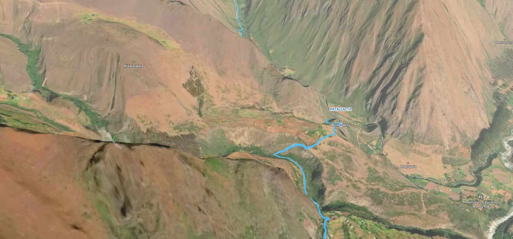

# Inca Trail 3D

**Live site:** https://alexamorbot.github.io/Inca-Trail-3D/

A GPS-accurate 3D walk of the classic Inca Trail, from the Km 82 trailhead at Piskacucho to Machu Picchu. The route, elevation, and stop photos come from a 2012 trek recorded on a Garmin handheld. The site is static HTML, CSS, and JavaScript. GitHub Pages serves it. There is no build step.



## See it

- [Enter the 3D tour](https://alexamorbot.github.io/Inca-Trail-3D/3dtour/)
- [How the tour was made](https://alexamorbot.github.io/Inca-Trail-3D/how-tour-was-made/)
- [How to reserve a permit](https://alexamorbot.github.io/Inca-Trail-3D/how-to-reserve-inca-trail/)
- [Terms](https://alexamorbot.github.io/Inca-Trail-3D/terms/)
- [GPS route download (KMZ)](https://alexamorbot.github.io/Inca-Trail-3D/data/Inca_Trail_GPS_Route.kmz)

### Stop guides

- [Piskacucho (Km 82)](https://alexamorbot.github.io/Inca-Trail-3D/stops/piskacucho/)
- [Patallaqta](https://alexamorbot.github.io/Inca-Trail-3D/stops/patallaqta/)
- [Camp 1, Wayllabamba](https://alexamorbot.github.io/Inca-Trail-3D/stops/camp-1-wayllabamba/)
- [Dead Woman's Pass](https://alexamorbot.github.io/Inca-Trail-3D/stops/dead-womans-pass/)
- [Camp 2, Pakaymayu](https://alexamorbot.github.io/Inca-Trail-3D/stops/camp-2-pakaymayu/)
- [Runkurakay](https://alexamorbot.github.io/Inca-Trail-3D/stops/runkurakay/)
- [Runkurakay Pass](https://alexamorbot.github.io/Inca-Trail-3D/stops/runkurakay-pass/)
- [Sayacmarca](https://alexamorbot.github.io/Inca-Trail-3D/stops/sayacmarca/)
- [Phuyupatamarca](https://alexamorbot.github.io/Inca-Trail-3D/stops/phuyupatamarca/)
- [Wiñay Wayna](https://alexamorbot.github.io/Inca-Trail-3D/stops/winay-wayna/)
- [Sun Gate](https://alexamorbot.github.io/Inca-Trail-3D/stops/sun-gate/)
- [Machu Picchu](https://alexamorbot.github.io/Inca-Trail-3D/stops/machu-picchu/)
- [Huayna Picchu](https://alexamorbot.github.io/Inca-Trail-3D/stops/huayna-picchu/)

## What the tour does

The tour page is a Mapbox GL JS flyover. Scrolling moves the camera along the recorded track. Each stop opens photos, narration, and a link to a written guide. A second map keeps the whole route in view.

- Mapbox GL JS 2.7.0, loaded from the Mapbox CDN
- Turf.js for the route geometry
- Terrain style: `mapbox://styles/noufelghayati/cl3m1xwi6006z15ld00w5tmt8`
- Overview style: `mapbox://styles/mapbox/dark-v10`
- Stop narration in `3dtour/audio/`
- Stop photos in `3dtour/img/`

Mapbox and OpenStreetMap attribution stay visible on the map.

## Mapbox token

The public token is in `3dtour/mapbox-token.js`. It is visible in the browser on purpose. Do not put a secret token (`sk.`) in this repo.

If the token is missing, the tour page shows a short notice in place of the map. The rest of the site still works.

## Layout

```
index.html                      Homepage
3dtour/index.html               3D tour
3dtour/mapbox-token.js          Public Mapbox token
3dtour/player.js                Camera and stop playback
3dtour/audio/                   Stop narration
3dtour/img/                     Stop photos
stops/                          Written guides
how-tour-was-made/              Build notes
how-to-reserve-inca-trail/      Permit guide
data/Inca_Trail_GPS_Route.kmz   GPS download
icons/                          Favicons
```

## Credits

Created by Alex Amor from a 2012 Inca Trail trek. GPS was captured on a Garmin handheld. Primary photos are from the trek team. Supplementary images are from Shutterstock. Tour interaction was built with Mapbox GL JS. Map data is © Mapbox © OpenStreetMap.

## Rights

Site content, photographs, narration, and the GPS track are all rights reserved unless a file says otherwise. Mapbox and OpenStreetMap data remain under their own terms.
